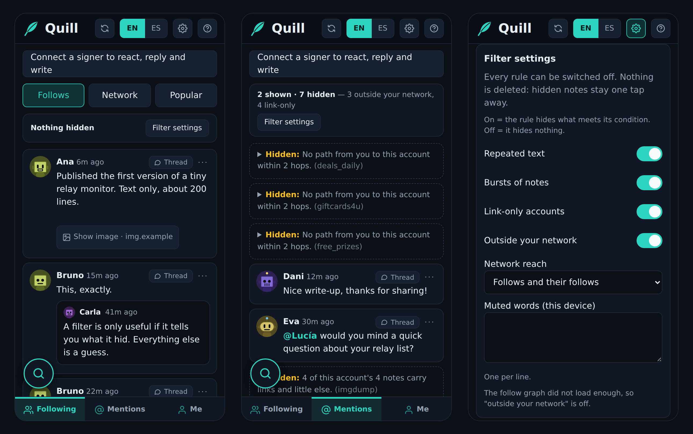
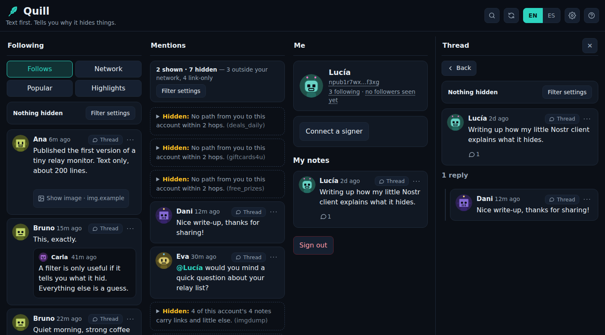

# Quill

**[English](README.md) · [Español](README.es.md)**

A small, **text-first** [Nostr](https://nostr.com) client that **tells you why it hides things**.

Live at **<https://quill.hivescope.xyz>**. Paste an `npub` to read; connect a NIP-46 signer ([Amber](https://github.com/greenart7c3/Amber) or [Primal](https://primal.net) on Android, [Clave](https://clave.casa) on iPhone, [nsec.app](https://nsec.app) on the web, or a bunker of your own) to react, reply and write. Quill never sees your private key.



On a computer the three tabs sit side by side and a thread, an account or a list opens in a panel on the right:


<sub>Screenshots with demo data (made-up accounts), not real people.</sub>

## Three promises

1. **Text first.** Nothing external is loaded unless you ask: a link to a picture shows a “Show image · site” button and only a tap loads it, straight from that site (Quill keeps no copy; an optional setting loads by themselves the pictures from people you follow and from what they repost or quote; video files get a “Show video” button and never load by themselves); no video, no link previews, no profile pictures from other servers unless you turn them on for the people you follow (otherwise avatars are drawn from the account's key and name). Links are shown as plain text with the whole address visible, and only open when you click them. This is enforced by the browser, not just by the code: the page ships a Content-Security-Policy that allows its own script, style and icons, and `wss://` connections to relays, nothing else.
2. **Light.** One static page, no backend, around 60 KB of JavaScript (gzipped).
3. **A filter that explains itself.** Nothing is hidden silently. Every hidden note is folded into one line that says which rule hid it and what the rule saw, and one tap shows it. A counter tells you how much was hidden and by what.

## How the filter decides

Every note gets a *verdict* (`src/core/verdict.ts`): shown or hidden, by which rule, with the numbers behind it. In order of precedence:

| Rule | Hides when | Never applies to |
|---|---|---|
| muted author / word | you muted them | — |
| repeated text | most of a key's notes are the same text other keys post (3+ words or a link) | you, people you follow |
| burst | 5+ notes inside a minute | you, people you follow |
| link only | 3+ notes, almost all with links | you, people you follow |
| outside your network | further than N hops in the follow graph (default 2) | you, people you follow |

Principles: behaviour is evidence, **missing data is not** (a key without a profile, or a follow graph that has not loaded yet, never hides anything by itself); people you chose are never hidden by behaviour; a short greeting repeated by many keys is a greeting, not spam. Each rule can be switched off. The rules come from the triage in [nostrclaw](https://github.com/rzazo24/nostrclaw).

## What it does

- **Following** (with what the people you follow repost, judged by the filter like everything else; a **Follows | Network | Popular | Highlights** switch widens it to the notes of the people they follow, each saying who follows its author, to notes by anyone that your follows reacted to or reposted in the last 24 hours, each saying who, or to Highlights: notes with substance (40+ words of their own) from the last two days that your follows talked about, quoted or shared, talk weighing more than likes), **Mentions** (where the filter earns its keep), **Me** (your account and your description, editable with a signer — only the description changes, the rest of your profile stays as it is —, your Clave connection, the filter settings, your own notes) and any **thread**.
- **In-app notifications**: a number on *Mentions*, new notes marked, a list of who reacted to or reposted your notes and of your new followers (accounts not seen following you on an earlier visit; a follower is whoever's newest follow list names you, and people who stop following you are noticed). Me shows how many you follow (exact) and about how many follow you (~: there is no official count, and every app counts its own way).
- **What your notes got**: in Me, under each note of yours, small numbers for the reactions, reposts and replies it received (nobody counts twice; you and your muted accounts do not count).
- **Drafts**: what you write is kept on the device as you type, and comes back when you open the same box again.
- **Zaps** your notes got (⚡ sats, and who sent them) in the numbers under each note in Me.
- **Zaps on other people's notes** too (only the zaps, never their reaction or repost counts).
- **Send zaps** with your own wallet through Nostr Wallet Connect (NIP-47): the connection string is kept only on that device, with a clear warning that it can spend; the invoice is checked to ask for exactly the amount chosen before the wallet pays it.
- **Save notes for later** from their …, kept whole on the device (Me › “N saved”).
- **Mentions while writing**: type @ and the start of a name to pick the account (people you follow first).
- **Comments** (NIP-22, kind 1111) show in threads, Mentions and your notes' numbers, next to classic replies.
- **Long-form articles** (NIP-23) referenced in notes open as text: title, author, summary, headings, paragraphs and lists, links written out in full.
- **Delete your own notes** from their … (it asks first and says what deleting can and cannot do).
- **Topics you care about** (Settings): notes about them get a “For you” mark, with the topic named; no AI, nothing reordered or hidden, kept on the device.
- **Search** (the magnifying-glass button): instant, on your device, in the notes and names Quill has already loaded (a single #tag also asks your own relays for its latest notes); “Search in: The network”, in Filters, asks two NIP-50 search relays only when chosen, and shows only what they found.
- **Account pages**: tap a name, an avatar or an @mention to see that account's profile (as text: its pictures are never loaded), how you are connected to it, **how much the network vouches for it** (a score out of 100 with the reason for every point, the same as nostrclaw's), and its notes and replies; with a signer connected, **follow / unfollow** and **mute / unmute** from there (muting is also in each note's …; your mute list is public, and Quill keeps the rest of it, private part included, as it is).
- **React** with one tap; **share** (repost) or **quote** a note after a confirmation; what you already reacted to or replied to is marked; **reply** and **write a note** through a review screen that shows the exact text, kind, tags and relays before anything is asked of your signer.
- **Wide screens**: on a computer (about 1100 px or more) **Following, Mentions and Me sit side by side**, each scrolling on its own, and a thread, an account or a list opens in a panel on the right. On a phone it stays one column with the tabs at the bottom.
- **Help**: a page with folding sections (the filter, writing with Clave, settings, install), behind the ? button, in both languages.
- **Avatars**: initials on a colour, robots, pixel figures or Halloween creatures (pumpkins, ghosts, bats, skulls, cats, spiders, witches), all drawn from the account's key (nothing is loaded).
- **Settings**: your own relay list (with a connection test; optionally published on Nostr as your NIP-65 list, and used as the starting point on a new device) and four text sizes, both remembered on the device.
- English and Spanish; dark theme; mobile first, and fine on a desktop.
- Installable as an app on iPhone and Android.

### What it does not do (on purpose, or not yet)

No direct messages, zaps, search, lists, media or long-form articles. The relay list is yours to edit in the ⚙ Settings (next to the language buttons) (secure `wss://` addresses only, 1 to 10, default six public relays), but it is one list for everything, not read per author (NIP-65). No system notifications (they would need a service worker and push); instead, while the app is open it looks once a minute and shows a number on *Mentions* for what is new since your last visit (replies, mentions and reactions to your notes; whatever the filter would hide is not counted, it is listed apart). No offline mode: the notes come live from the relays, so a cached copy would only show an empty shell.

## Writing: Quill never sees your private key

*Connect Clave* asks you to paste the **`bunker://` address** that Clave gives you (or press *Paste and connect* after copying it in Clave). Clave holds the key and signs; Quill keeps only an app key, saved in this browser, that identifies it to Clave.

**Why `bunker://` and not a link:** Clave signs in the background only for clients paired this way (its push service wakes it for requests sent through `relay.powr.build`). With a `nostrconnect://` link or QR, tested on an iPhone, Clave answered only while it was open on screen. The link is still offered as an alternative (*Use a link instead*).

**Any NIP-46 signer works, including one you run yourself.** The field takes any `bunker://` address, not only Clave's. If you would rather not depend on a phone app waking up, you can run your own signer on a server you control (the author uses [hivescope-bunker](https://github.com/rzazo24/hivescope-bunker): the key encrypted on disk, unlocked by hand after each restart, and a separate connection per app that may sign only the kinds of event that app needs, with an hourly limit). The trade-off is real: the key then lives (encrypted) on that server instead of in your phone's keychain. Quill asks such a signer for the same things it asks Clave, and its own signing policy applies either way. Each new pairing starts with a fresh app key, so a connection you deleted in the signer can be paired again.

- Quill sends **one** request to the signer (one notification) and waits up to 90 seconds, with a Cancel button; nothing is published unless the signer signs. A new tap replaces a request still waiting.
- What comes back is **verified**: valid signature, your key, and exactly the kind, content and tags that were asked for (a signer that adds a hidden mention is refused). Then it publishes to the relays and shows the result **per relay**, with a retry for the ones that failed that needs no new signature.
- Quill's own policy only ever signs notes (≤ 1000 characters), reactions, reposts (of a real, validly signed text note, after a confirmation), changes of your follow list (your newest list with exactly one account added or removed, never built from a stale or partial copy) and, when you press the button in Settings, your relay list (NIP-65, kind 10002, in exactly the shape Quill builds), at most 20 signatures per hour (and, apart from those, 40 reactions per hour), **whatever trust level you give it in the signer**. Suggested level for Quill in Clave: *medium* (it auto-approves kinds 1, 6 and 7, which is all Quill needs); *full* also approves deletions, follow lists and relay lists, which Quill never asks for.
- A signer for a different account than the one you are reading as is refused and disconnected.

## Install it as an app

- **iPhone (Safari):** Share → Add to Home Screen.
- **Android (Chrome):** menu → Install app.

Once installed it opens full screen with its own icon. It **keeps its own data**, separate from the browser: you log in and connect your signer again inside it. There is no pull-to-refresh: use the **↻** button, tap the current tab again, or just come back after a few minutes (it refreshes by itself after two).

**New versions announce themselves.** Every build has an id, published as `/version.json`; the app compares it with its own when it starts, when you come back to it and every ten minutes, and shows an *Update* bar when they differ (the button just reloads the page).

## Develop

```bash
npm install
npm test            # unit and integration tests (the signer against a real relay binary is skipped without RELAY_BIN)
npm run build       # type-check + production build
npm run dev
```

Checks in real browsers (Playwright's Chromium), run against `npm run build`:

```bash
node test/e2e.mjs <npub>               # the whole reading flow against the real relays
npm run e2e:sign                       # connection handshake with a pretend Clave (QUILL_URL=… tests a deployed copy)
npm run e2e:pwa                        # is the page installable, is the manifest right, does the update notice work
node test/e2e-shell.mjs <hex pubkey>   # the layout: the page never scrolls, only the content; the tab bar never moves
node test/e2e-align.mjs <hex pubkey>   # desktop alignment with classic scrollbars shown
npm run probe -- <npub>                # the data layer against the real relays: what the filter would do
npm run screenshots                    # regenerates docs/screenshot*.png from made-up demo data (run npm run build first)
```

Layout of the code: `src/core` pure logic (text safety, threads, the filter) · `src/data` loading follows, graph, mutes, feeds · `src/net` the only code that talks to relays (it drops events with a bad signature or that do not answer the question asked) · `src/sign` the NIP-46 signer, the signing policy and the sign-and-publish pipeline · `src/ui` the page (DOM built with `textContent`, never `innerHTML`). `CLAUDE.md` has the design rules that must not erode and what was learned about iOS, Android and Clave.

### Deploy

`scripts/deploy.sh <relay-repo> <domain>` builds, copies `dist/` next to a [Caddy](https://caddyserver.com) site block (`deploy/quill.caddy.template`, with the strict security headers), **validates the whole Caddy configuration** and only then reloads it; if validation fails it restores the previous files.

Optional: `server/avatars` (Go, no native dependencies) serves profile pictures as small square thumbnails at `/avatar?u=<picture>&s=96`, fetched once by the server and kept on disk, so readers download a few kilobytes instead of megabytes and the picture hosts see the server, not the reader. It only fetches public `https` addresses (checked when connecting), at most 8 MB, images only, with a per-client rate limit. Build it with `go build` there, run it as a service listening where only Caddy can reach it (the site block proxies `/avatar` to it). Without it, pictures come straight from their sites.

## Prior art

Looked at before starting (October 2026): Coracle hides notes under a web-of-trust threshold without saying why; nostui is a terminal client with no spam filtering.

## License

[MIT](LICENSE) © 2026 rzazo24. Free to use, copy, modify and distribute, with no warranty.
